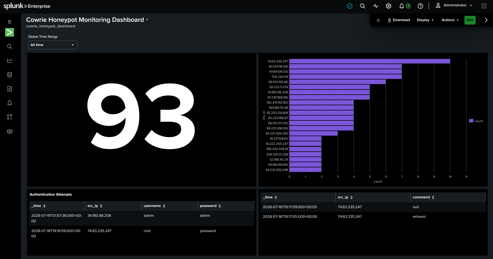
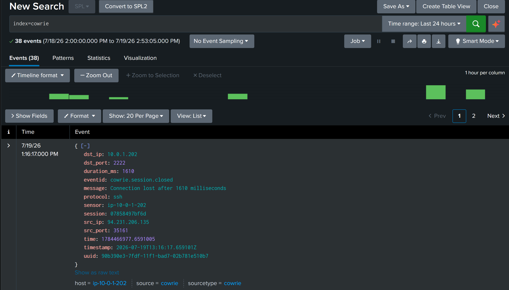
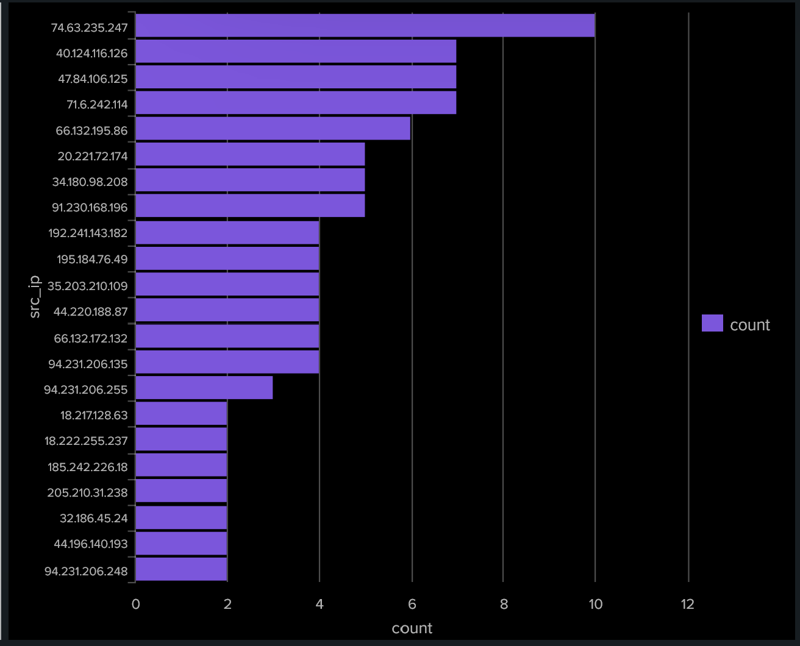
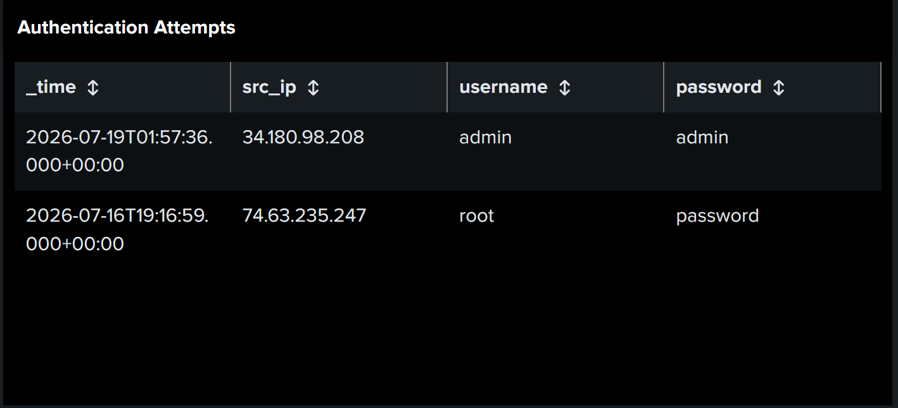
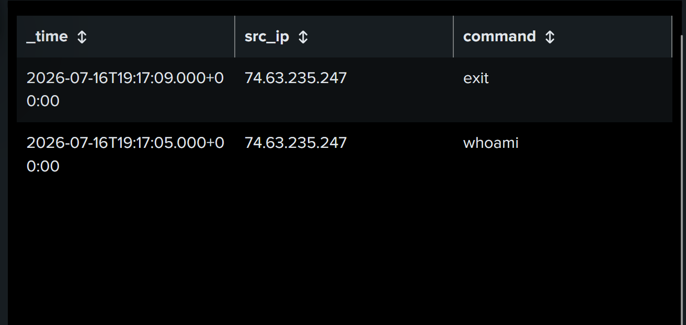

# 🛡️ AWS Cloud SSH Honeypot Monitoring Lab (Cowrie + Splunk Enterprise)

# 📌 Project Overview

This project demonstrates how I built an SSH honeypot using AWS, Ubuntu Linux, Cowrie, and Splunk Enterprise. The environment captures SSH login attempts, forwards the events to Splunk for analysis, and provides hands-on experience with Linux, AWS, networking, and security monitoring.

---

# 🎯 Objectives

* Deploy a cloud-hosted Cowrie SSH honeypot on AWS.
* Deploy Splunk Enterprise as a centralized SIEM.
* Configure HTTP Event Collector (HEC) for secure log ingestion.
* Validate end-to-end event collection and analysis.
* Continuously collect and analyze real-world SSH attack activity.

---

# 🛠️ Technologies Used

* Amazon Web Services (AWS)
* Amazon EC2
* Ubuntu Server
* Cowrie SSH Honeypot
* Splunk Enterprise
* HTTP Event Collector (HEC)
* SSH
* Linux CLI
* SCP
* Python Virtual Environment
* JSON
* Search Processing Language (SPL)


---

---

# 🏗️ Architecture Overview

* Two Ubuntu-based Amazon EC2 instances deployed within AWS.
* Cowrie SSH honeypot captures inbound SSH login attempts.
* Security events are forwarded to Splunk Enterprise using the HTTP Event Collector (HEC).
* Events are indexed in a dedicated **cowrie** index.
* Splunk Search & Reporting is used to search, monitor, and visualize attack activity.

```text
                    Internet
                        │
          Automated SSH Login Attempts
                        │
                        ▼
         AWS EC2 (Ubuntu + Cowrie Honeypot)
                 TCP 2222 (SSH)
                        │
           JSON Events via HEC (TCP 8088)
                        │
                        ▼
       AWS EC2 (Ubuntu + Splunk Enterprise)
               Index: cowrie
                        │
                        ▼
       SPL Searches • Dashboards • Analysis
```

---

# 🌐 Environment Configuration

* **Cowrie Server:** Ubuntu EC2 instance running the Cowrie SSH honeypot.
* **Splunk Server:** Ubuntu EC2 instance running Splunk Enterprise.
* **SSH Management:** TCP Port **22** restricted to **My IP**.
* **Cowrie Honeypot:** TCP Port **2222** open to capture SSH attack attempts.
* **Splunk Web Interface:** TCP Port **8000** restricted to **My IP**.
* **HTTP Event Collector (HEC):** TCP Port **8088** for secure event forwarding.
* **Event Storage:** Dedicated **cowrie** index for centralized log collection.


---

# ⚙️ Implementation Summary

* Deployed two Ubuntu-based Amazon EC2 instances for Cowrie and Splunk Enterprise.
* Installed and configured the Cowrie SSH honeypot to capture SSH login attempts.
* Installed and configured Splunk Enterprise on a dedicated EC2 instance.
* Created a dedicated **cowrie** index and configured the HTTP Event Collector (HEC).
* Integrated Cowrie with Splunk to securely forward JSON event data.
* Validated end-to-end event ingestion using controlled SSH login attempts.
* Configured the environment to continuously collect and analyze real-world SSH attack activity.


---

# ✅ Validation & Results

* Successfully verified end-to-end event ingestion from Cowrie to Splunk Enterprise using HTTP Event Collector (HEC).
* Confirmed SSH login attempts were captured, indexed, and searchable within the **cowrie** index.
* Validated the environment using Splunk Search Processing Language (SPL) queries.
* Configured the honeypot to continuously collect and monitor real-world SSH attack activity.

### Sample SPL Queries

```spl
index=cowrie
```

```spl
index=cowrie
| stats count
```

```spl
index=cowrie
| top src_ip
```

```spl
index=cowrie
| top username
```

## 📸 Screenshots

### Cowrie Honeypot – Splunk Security Dashboard

This dashboard provides an overview of the activity captured by the Cowrie honeypot. I used Splunk to monitor incoming SSH connections, review authentication attempts, and get a better picture of how external sources were interacting with the system.



### Splunk Raw Event Logs

This screenshot shows the raw events collected by the Cowrie honeypot and displayed in Splunk. Each event provides details such as timestamps, source IP addresses, destination ports, and SSH activity, allowing me to examine individual connection attempts and identify suspicious behavior.



### Source IP Address Analysis

This screenshot shows the different IP addresses that attempted to connect to the Cowrie honeypot. Using Splunk, I was able to identify where connection attempts were coming from and see which sources were generating the most activity.




### SSH Authentication Attempts

This screenshot shows authentication attempts captured by the Cowrie honeypot and recorded in Splunk. The logs provide insight into how external sources attempted to access the system, including the usernames used and whether the login attempts succeeded or failed.




### Commands Executed During SSH Sessions

This screenshot shows commands entered by external sources after gaining access to the simulated SSH environment. Commands such as `whoami` and `exit` were captured by Cowrie and logged in Splunk, providing insight into how attackers interacted with the honeypot after authentication.



---

# 💡 Skills Demonstrated

* AWS Cloud Infrastructure
* Linux Administration
* Network Security
* Splunk Enterprise (SIEM)
* HTTP Event Collector (HEC)
* SSH & Secure Remote Administration
* Security Monitoring & Log Analysis
* Search Processing Language (SPL)
* Troubleshooting & Root Cause Analysis

---

# 📚 Lessons Learned

* Strengthened Linux system administration and troubleshooting skills.
* Gained hands-on experience deploying and integrating a SIEM solution.
* Developed a deeper understanding of secure log collection and event analysis.
* Reinforced the importance of validating end-to-end connectivity in cloud environments.

---

# 🚀 Future Enhancements

*This section will be updated as additional real-world SSH attack activity is collected and analyzed.*

